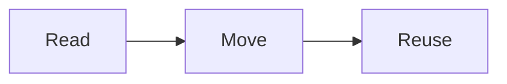

Part 2

# Open Publishing Space 2

A free, open-source website starter for sharing **web-first open textbooks and guides** alongside a blog and other pages, built on the newly released Grav 2 CMS.

- Guides with section cards, reading progress, Learning Objectives, OER attribution, search and **Keep My Place** (come back to this guide's home page to continue where you left off, even partway down a page)
- One site can hold several guides, each with a card on a Guides page and its own pages in the menu (like this guide's Topics and Resources) – plus site pages like [About](https://demo.hibbittsdesign.org/read-move-reuse-ops-quark2/about)
- Diagrams and math written as plain text, with the free [Mermaid](https://hibbittsdesign.org/cost-free-grav-projects.html#mermaid-plugin) and [LaTeX Math](https://hibbittsdesign.org/cost-free-grav-projects.html#latex-math-plugin) plugins – like $E = mc^2$, or this diagram:

Pages **embed in Canvas, Moodle or Brightspace** – just add `?embedded=true` to a page's address.

Editing works **in the browser** with Grav's Admin 2 panel, or as Markdown files with any editor or **via Git** – with no database needed, on almost any standard PHP web host.

> [!TIP]
> 
> You're reading this page embedded – the same way it would appear inside Canvas, Moodle or Brightspace.

*A guide home page, from the Open Publishing Space demo*

*A page of this guide on a phone: the header slides away as you read, and Previous/Next stay at the bottom*

See the demo: [one guide](https://demo.hibbittsdesign.org/grav-open-publishing-quark2/) · [several guides](https://demo.hibbittsdesign.org/grav-open-publishing-quark2-guides/) · [This page, embedded](https://demo.hibbittsdesign.org/read-move-reuse-ops-quark2/open-publishing-space/open-publishing-space?embedded=true)

Try the Admin 2 panel: [read-only demo](https://try.hibbittsdesign.org/grav-skeleton-open-publishing-space/admin) (the sign-in details are on its sign-in screen). Once signed in, the project's ReadMe is in the Admin sidebar, thanks to the [Admin2 Site ReadMe plugin](https://hibbittsdesign.org/cost-free-grav-projects.html#admin2-site-readme-plugin).

This work by [Paul Hibbitts](https://hibbittsdesign.org/) is licensed under [CC BY 4.0](https://creativecommons.org/licenses/by/4.0/). Cover photo by [Michaela St](https://unsplash.com/@michaela_st) on [Unsplash](https://unsplash.com/photos/an-open-book-flying-in-the-air-L23ydbfeO2s).

- [Why It Matters](https://demo.hibbittsdesign.org/read-move-reuse-ops-quark2/open-publishing-space/why-it-matters)
- [Open Publishing Space 2](https://demo.hibbittsdesign.org/read-move-reuse-ops-quark2/open-publishing-space/open-publishing-space)
- [From Pressbooks](https://demo.hibbittsdesign.org/read-move-reuse-ops-quark2/open-publishing-space/from-pressbooks)
- [Accessibility and Privacy](https://demo.hibbittsdesign.org/read-move-reuse-ops-quark2/open-publishing-space/accessibility)
- [Getting Started](https://demo.hibbittsdesign.org/read-move-reuse-ops-quark2/open-publishing-space/getting-started)

Want to jump right in? Download [Open Publishing Space](https://getgrav.org/downloads/skeletons#open-publishing-space-site) or try the [demo](https://demo.hibbittsdesign.org/grav-open-publishing-quark2/).

---

## Navigation

- Parent: [Open Textbooks and Guides](https://demo.hibbittsdesign.org/read-move-reuse-ops-quark2/open-publishing-space.md)
- Previous: [Why It Matters](https://demo.hibbittsdesign.org/read-move-reuse-ops-quark2/open-publishing-space/why-it-matters.md)
- Next: [From Pressbooks](https://demo.hibbittsdesign.org/read-move-reuse-ops-quark2/open-publishing-space/from-pressbooks.md)
