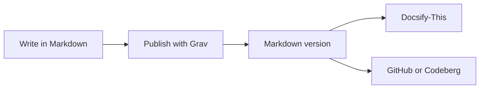
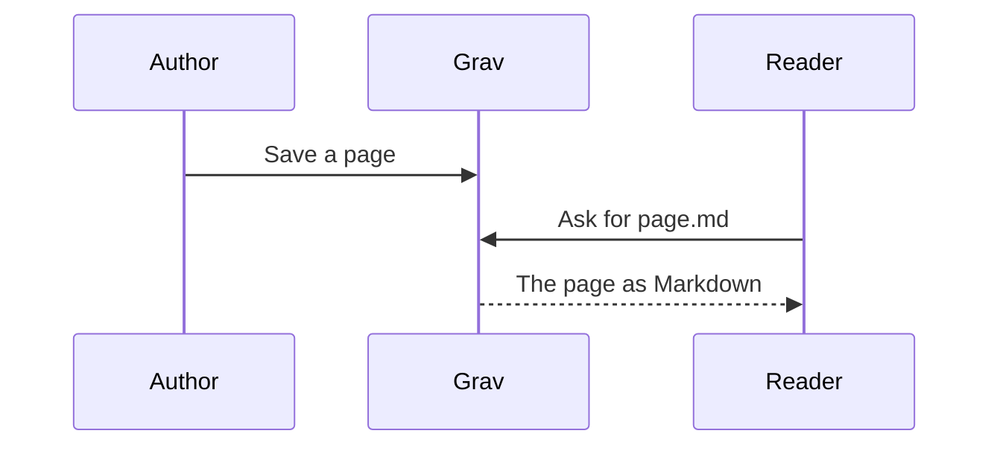
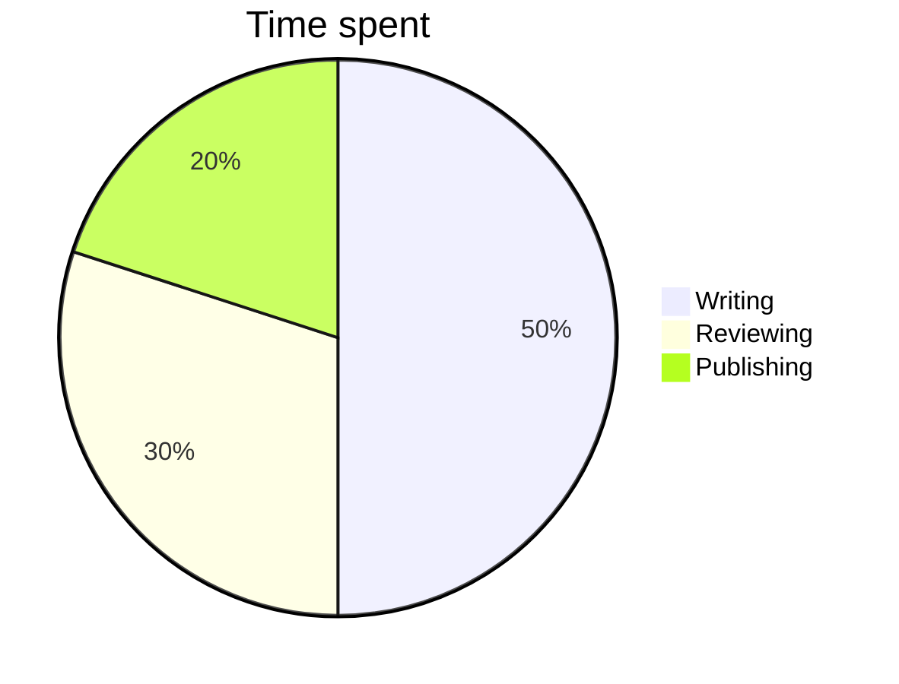

# Portable Content Test

A test page for content that should look the same here, in this page's Markdown version (add `.md` to its address) and in Docsify-This: callouts, LaTeX math and Mermaid diagrams.

## Callouts

> [!NOTE]
> 
> A note, for useful background. It can hold **bold**, *italics*, `code` and [a link](https://docsify-this.net).

> [!TIP]
> 
> A tip, with a list:
> 
> - Write once in Markdown
> - Show it anywhere
> - Let others reuse it

> [!IMPORTANT]
> 
> Something readers shouldn't miss, over two paragraphs.
> 
> This is the second paragraph.

> [!WARNING]
> 
> A warning, with a numbered list:
> 
> 1. Keep a copy of your files
> 2. Check the licence before you reuse

> [!CAUTION]
> 
> A caution, for actions that can't be undone.

## LaTeX Math

Within a sentence: the area of a circle is $A = \pi r^2$, and the average of $x_1$ to $x_n$ is $\bar{x}$. Prices such as $5 and $10 stay as text.

A block:

$$ \bar{x} = \frac{1}{n} \sum_{i=1}^{n} x_i $$

Steps lined up, with `\\` for new lines:

$$ \begin{aligned} (a + b)^2 &= (a + b)(a + b) \\ &= a^2 + 2ab + b^2 \end{aligned} $$

A matrix and chemistry: $\begin{pmatrix} 1 & 2 \\ 3 & 4 \end{pmatrix}$ and $\ce{2H2 + O2 -> 2H2O}$.

A math block:

$$ e^{i\pi} + 1 = 0 $$

## Math Inside a Callout

> [!TIP]
> 
> The quadratic formula solves $ax^2 + bx + c = 0$:
> 
> $$ x = \frac{-b \pm \sqrt{b^2 - 4ac}}{2a} $$

## Mermaid Diagrams

A flowchart:



A sequence diagram:



A pie chart:



## Code Stays Code

`$x$`, `> [!NOTE]` and this block are code, so nothing in them is drawn:

```markdown
> [!NOTE]
> A callout written in Markdown, with $x^2$ math.
```

---

## Navigation

- Previous: [Read Me](http://localhost:8080/_TESTS/grav-skeleton-open-publishing-space/readme.md)
- Next: [Search](http://localhost:8080/_TESTS/grav-skeleton-open-publishing-space/search.md)
